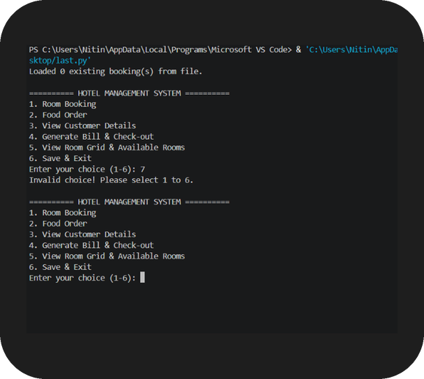
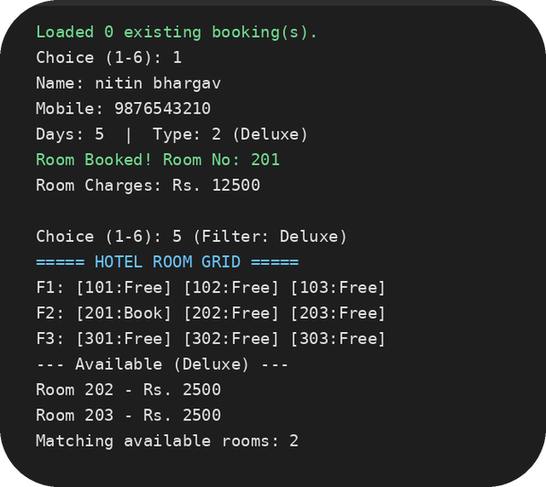
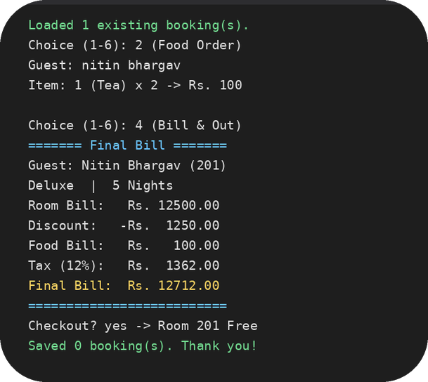
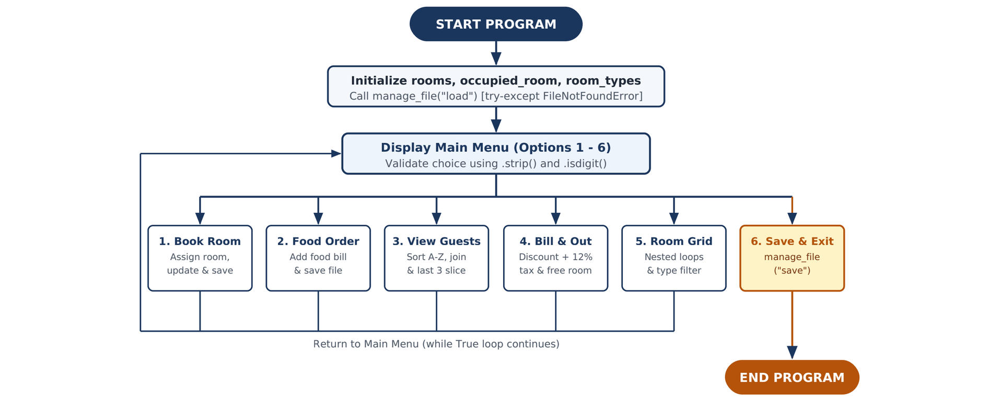
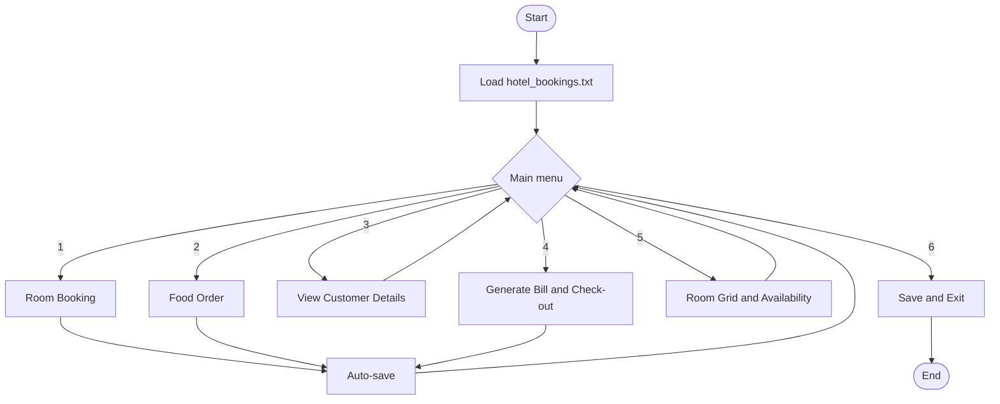

<div align="center">

# 🏨 Hotel Room Booking System

### A menu-driven Python console application for room allocation, food ordering, automated billing and persistent storage


**Python Programming (BCS1703) · Group 15 · Sitare University**

[Features](#-features) · [Quick Start](#-quick-start) · [Demo](#-sample-run) · [How It Works](#-how-it-works) · [Team](#-team)

</div>

---

## 📖 Overview

Running a hotel front desk on paper is slow and error-prone. This project replaces the manual register with a small, dependable Python program that handles the full guest journey, from check-in to check-out.

| Problem with a manual register | How this system solves it |
|---|---|
| **Overbooking:** no live tracking of rooms leads to duplicate assignments | A `set` of occupied rooms makes a double booking impossible |
| **Billing errors:** discount and 12% tax maths done by hand goes wrong | Billing is automated: slab discounts, tax and an itemised invoice |
| **Lost records:** paper or RAM-only logs vanish on restart | Bookings are auto-saved to `hotel_bookings.txt` and reloaded on start |
| **Slow lookups:** hard to find a free room of a given category | Live room grid with a Standard / Deluxe / Luxury filter |

The program uses only the Python standard library and concepts from **Lectures 1 to 13**: data structures, functions, loops, string handling, slicing, file handling and exception handling.

---

## ✨ Features

- 🛏️ **Smart room allocation:** automatically assigns the first free room of the chosen type
- 🚫 **Overbooking prevention:** a booked room cannot be assigned again until check-out
- 🛡️ **Crash-proof input:** every prompt is validated in a loop, so bad input never crashes the program
- 🍽️ **Room-service ordering:** five menu items, with case-insensitive guest lookup
- 👥 **Guest directory:** alphabetically sorted names, full guest cards, and the 3 most recent bookings
- 🧾 **Automated billing:** long-stay discounts, 12% tax and a formatted invoice
- 🏢 **Live room grid:** 3 floors × 3 rooms, with availability filtered by room type
- 💾 **Persistent storage:** auto-saves after every change, safe on a first run with no file

---

## 🚀 Quick Start

**Requirements:** Python 3.8 or newer. No external packages are needed.

```bash
# 1. Clone the repository
git clone https://github.com/nit1234in/HOTEL_ROOM_BOOKING_SYSTEM.git
cd HOTEL_ROOM_BOOKING_SYSTEM

# 2. Run the program
python hotelroommanagement.py
```

On the first run there is no data file yet, and the program starts cleanly with `Loaded 0 existing booking(s) from file.` A `hotel_bookings.txt` file is created automatically once you make a booking.

---

## 🎮 Main Menu

```text
========== HOTEL MANAGEMENT SYSTEM ==========
1. Room Booking
2. Food Order
3. View Customer Details
4. Generate Bill & Check-out
5. View Room Grid & Available Rooms
6. Save & Exit
```

---

## 🖥️ Sample Run

**Booking a room**

```text
Enter customer name: nitin bhargav
Enter 10-digit mobile number: 9876543210
Enter no of days: 5

--------ROOM TYPE--------
1 . Standard Room - Rs. 1500 Per Night
2 . Deluxe Room - Rs. 2500 Per Night
3 . Luxury Room - Rs. 4000 Per Night
Enter Room Choice (1-3): 2

Room Booked Successfully!
Assigned Room: 201
Customer Name: Nitin Bhargav
Room Type: Deluxe
Room Charges: Rs. 12500
```

**Room grid**

```text
========== HOTEL ROOM GRID ==========
Floor 1 :  [101: Available]  [102: Available]  [103: Available]
Floor 2 :  [201: Booked]  [202: Available]  [203: Available]
Floor 3 :  [301: Available]  [302: Available]  [303: Available]
```

**Final bill and check-out**

```text
===== Final Bill ======
Customer Name: Nitin Bhargav
Mobileno: 9876543210
Room Type: Deluxe
Room Number: 201
Days Stayed: 5
Room Bill:    Rs. 12500.00
Discount:    -Rs. 1250.00
Food Bill:    Rs. 100.00
Tax (12%):    Rs. 1362.00
Final Bill:   Rs. 12712.00
=======================================
Do you want to checkout this guest? (yes/no): yes
Check-out successful! Room 201 is now Available.
```

### 📸 Verified Terminal Runs

| 1. Wrong input guard | 2. Booking & room grid | 3. Bill, check-out & save |
|:---:|:---:|:---:|
|  |  |  |
| Out-of-range choice `7` is handled cleanly with 0 crashes | Deluxe Room 201 is assigned and the grid shows it as booked | Reloaded booking, Rs. 12,712.00 bill, and Room 201 freed |

---

## 🏨 Rooms, Rates & Menu

### Rooms (9 rooms across 3 floors)

| Floor | Rooms | Type | Rate per night |
|:---:|:---:|:---:|---:|
| 1 | 101, 102, 103 | Standard | Rs. 1,500 |
| 2 | 201, 202, 203 | Deluxe | Rs. 2,500 |
| 3 | 301, 302, 303 | Luxury | Rs. 4,000 |

### Food menu

| # | Item | Price |
|:---:|---|---:|
| 1 | Tea | Rs. 50 |
| 2 | Coffee | Rs. 100 |
| 3 | Lunch | Rs. 300 |
| 4 | Snacks | Rs. 150 |
| 5 | Dinner | Rs. 450 |

### Billing rules

| Stay length | Discount on room bill |
|:---:|:---:|
| 1 to 3 days | None |
| 4 to 6 days | **10%** |
| 7 days or more | **15%** |

```text
sub_total  = (room_bill - discount) + food_bill
tax        = 12% of sub_total
final_bill = sub_total + tax
```

The discount applies **only to the room bill**. Food is charged at full price, and tax is applied on the combined subtotal.

---

## 🧠 How It Works

### Core data structures

| Structure | Variable | Purpose |
|---|---|---|
| `dict` | `rooms` | Stores the 9 fixed rooms (101 to 303) with type, price and status |
| `set` | `occupied_room` | Blocks double bookings with fast membership checks, since sets cannot hold duplicates |
| `tuple` | `room_types` | Immutable rate card for Standard, Deluxe and Luxury, so it cannot be changed by mistake |
| `list` | `customers` | Dynamic list of active guest records, each stored as a dictionary |

### Program flow

<p align="center">
  
</p>

The same flow as an interactive diagram:



### Functions

| Function | Responsibility | Concepts used |
|---|---|---|
| `room_booking()` | Validates guest details, picks a room type, assigns the first free room and records the booking | `while` loops, `.strip()`, `.title()`, `.isdigit()`, tuple unpacking, set membership |
| `food_order()` | Finds the guest case-insensitively, then validates the item and quantity and updates the food bill | `found` flag, input validation, `if/elif` |
| `view_customer_details()` | Prints sorted names, full guest cards and the last 3 bookings | `list.sort()`, `", ".join()`, slicing `customers[-3:]` |
| `generate_bill()` | Applies the discount and tax, prints the invoice and handles check-out | `if/elif/else` slabs, f-string formatting `:.2f` |
| `show_room_grid(filter_type)` | Draws the floor-by-room grid and lists free rooms by type | Nested loops, default argument, return value |
| `manage_file(mode)` | Saves or loads all guest records with one parameter | `with open()`, `join()` / `split()`, `try/except FileNotFoundError` |

### Data file format

Each guest is stored as one comma-separated line in `hotel_bookings.txt`:

```text
name,mobile,room_no,room_type,days,room_bill,food_bill
Nitin Bhargav,9876543210,201,Deluxe,5,12500,100
```

On startup, each line is parsed back into a guest record and its room is marked **Booked** again.

---

## 🛡️ Design Decisions

| Decision | Reason |
|---|---|
| **Loops instead of recursion** | Easier for beginners to trace and debug |
| **Validate before converting** | `.strip()` and `.isdigit()` are checked *before* `int()`, which avoids `ValueError` crashes |
| **Not-found check after the loop** | Prevents the "Customer not found" message from printing repeatedly |
| **Check `days >= 7` before `days >= 4`** | Makes the 15% slab reachable, because the wrong order would hide it |
| **`try/except FileNotFoundError`** | The program starts cleanly on a first run with no data file |
| **Auto-save after every change** | Booking, ordering and check-out never lose data if the program closes unexpectedly |

---

## 📁 Project Structure

```text
HOTEL_ROOM_BOOKING_SYSTEM/
├── hotelroommanagement.py   # Complete application
├── hotel_bookings.txt       # Auto-generated guest records (created on first booking)
├── flowchart.png            # Program flowchart
├── wrong-input.png          # Terminal run 1
├── booking-and-grid.png     # Terminal run 2
├── bill-checkout.png        # Terminal run 3
└── README.md
```

---

## 🔭 Known Limitations & Future Scope

- 🔎 **Room-number lookup:** guests are currently found by name, so two guests with the same name would clash
- 🧼 **Comma-safe names:** names containing a comma would break the comma-separated file format
- 📚 **Revenue archive:** keep a log of completed stays and total revenue
- 📅 **Date-based bookings:** check-in and check-out dates in place of a plain day count
- 🗄️ **SQLite database:** a more robust replacement for the text file
- 🖼️ **GUI:** a Tkinter interface for front-desk staff

---

## 👨‍💻 Team

**Group 15 · Python Programming (BCS1703)**

| Member | Enrollment No. | Module |
|---|---|---|
| **Nitin Bhargav** | 202610101200010 | `room_booking()` and `manage_file()` |
| **Beeraka Sharath** | 202610101200015 | `food_order()` and `show_room_grid()` |
| **Kalpana Kumari** | 202610101200005 | `view_customer_details()` |
| **Amit Tiwari** | 202610101200039 | `generate_bill()` |

**Instructor:** Mr. Ajay Sonkar · **Institution:** Sitare University · **Date:** 22 November 2026

---

<div align="center">

⭐ If you found this project useful, consider giving it a star.

*Built with Python 🐍 by Group 15*

</div>
